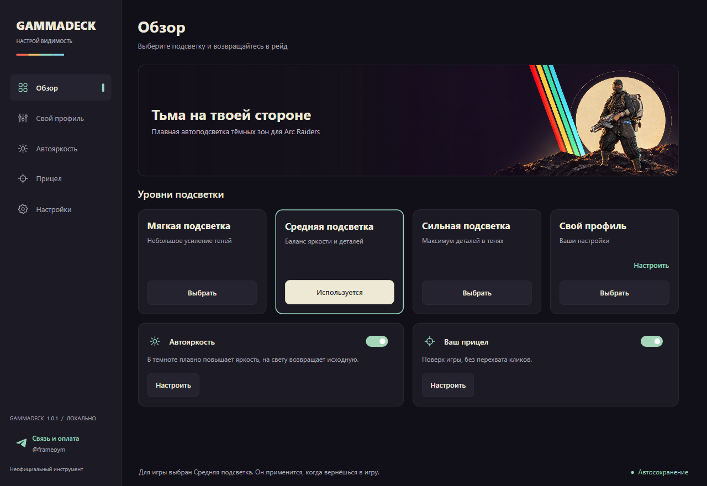
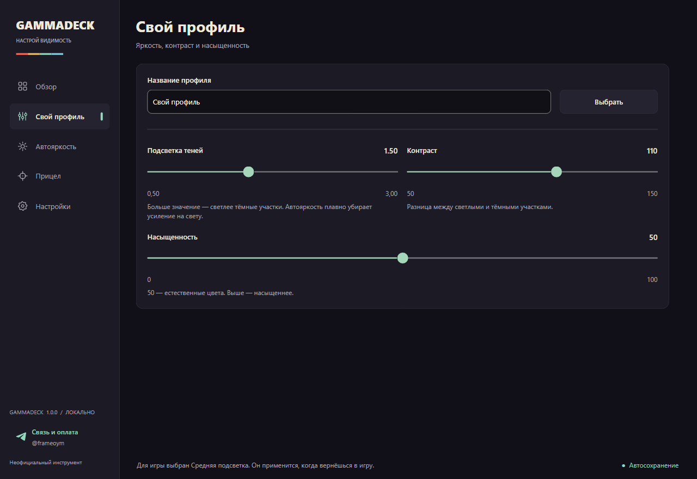
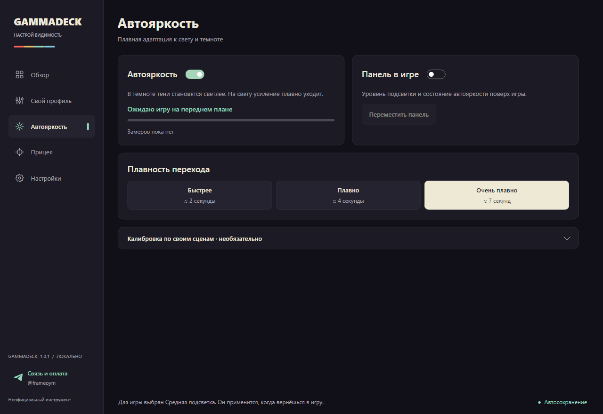
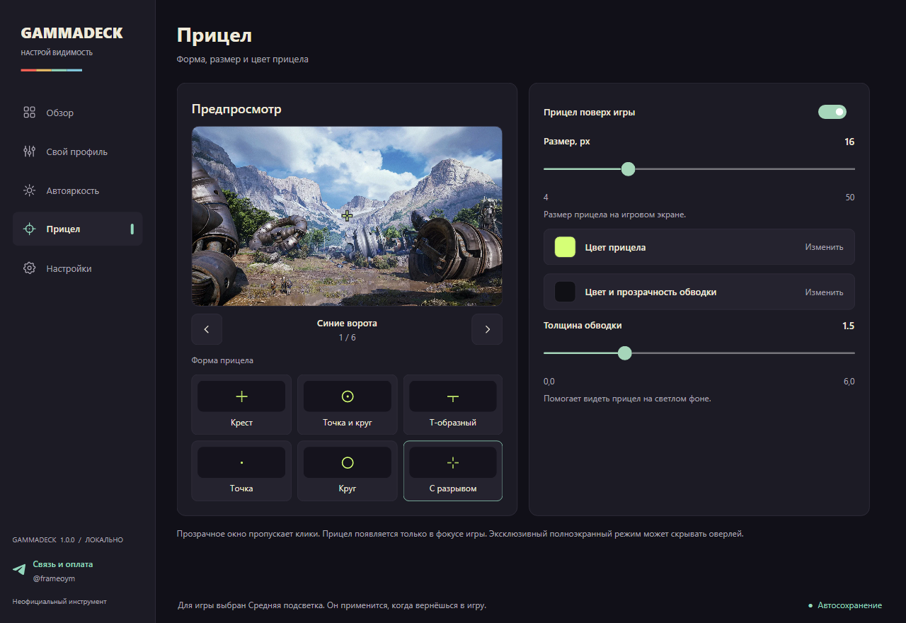
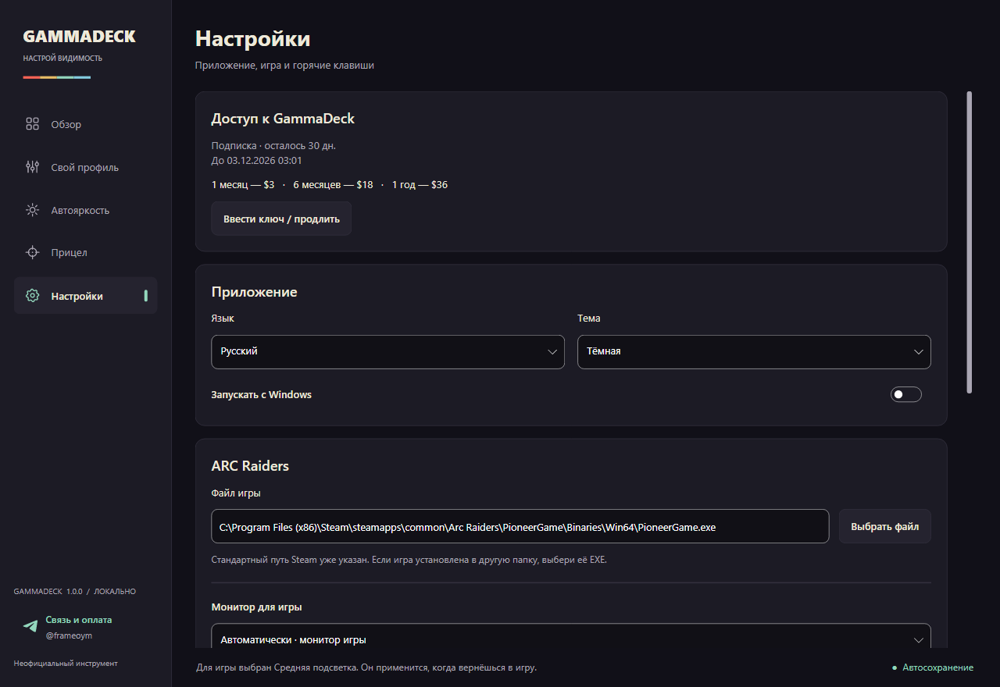

# GammaDeck · ARC Raiders

**Тьма на твоей стороне.** Плавная автоподсветка тёмных зон для ARC Raiders.

[Скачать / Download](https://github.com/FrameDesignlll/GammaDeck/releases/latest) · [English](#english) · [Связь и оплата / Contact & payment](https://t.me/frameoym)

## По-русски

GammaDeck — утилита для Windows x64, которая помогает разглядеть детали в тёмных местах ARC Raiders. Один раз настройте её, выберите подсветку и сверните в трей: дальше приложение работает в фоне.

- **Плавная автояркость:** в темноте усиливает подсветку, на свету возвращает исходную яркость. Максимум задаёт выбранный профиль.
- **Три готовых уровня** — мягкий, средний и сильный — и свой профиль с настройкой яркости, контраста и насыщенности.
- **Только в игре:** при Alt-Tab исходные цвета рабочего стола восстанавливаются. При запуске приложения подсветка выключена, профиль выбираете вы.
- **Прицел:** настройка формы, размера, цвета, обводки и прозрачности; ручной предпросмотр на шести игровых картах.
- Горячие клавиши, отключаемые уведомления и обновления из приложения. Интерфейс на русском и английском.

### Начало работы и доступ

Скачайте ZIP из [последнего выпуска](https://github.com/FrameDesignlll/GammaDeck/releases/latest), распакуйте и запустите **GammaDeck.exe**. Устанавливать .NET не нужно. В обзоре выберите уровень подсветки; для автоматической адаптации включите автояркость. При нестандартной установке укажите файл ARC Raiders в настройках.

Первые **3 дня** доступны три готовых профиля и автояркость. Свой профиль и прицел требуют ключ. После окончания триала для дальнейшего использования нужен ключ.

**1 месяц — $3 · 6 месяцев — $18 · 1 год — $36.** Для оплаты и активации напишите [@frameoym в Telegram](https://t.me/frameoym) и передайте код ПК из приложения. Ключ привязан к этому ПК, вводится один раз; срок идёт с момента выдачи. Автоматического списания и встроенной оплаты пока нет. После переустановки Windows может потребоваться новый ключ.

Ранее выданные бессрочные ключи автоматически получают **год доступа с первого запуска версии 1.0.0 или новее**, без повторного ввода. Настройки сохраняются, дата окончания показана в настройках.

### Как работает и что с безопасностью

Автояркость анализирует яркость небольших участков изображения через штатный захват Windows GDI и плавно меняет гамму экрана. Настройка насыщенности использует поддерживаемые функции драйвера NVIDIA. Прицел рисуется отдельным прозрачным окном поверх игры и пропускает клики; захват игры для его отрисовки не нужен.

GammaDeck **не читает и не изменяет память игры, не внедряет DLL и не выполняет игровые действия**. Необязательные настройки оптимизации меняют приоритет процесса и привязку к ядрам средствами Windows. Это не официальное одобрение Embark или гарантия совместимости с античитом.

Активация проверяется локально по цифровой подписи; приватный ключ не включён в приложение. Есть проверки отката часов и защищённые резервные отметки срока, но офлайн-защиту нельзя считать невзламываемой. Захваченные участки для автояркости не отправляются на сервер. Для проверки и загрузки обновлений приложение обращается к GitHub по HTTPS и проверяет размер и SHA-256 скачанного файла.

Автояркость рассчитана на **SDR** и приостанавливается при HDR. Результат зависит от режима игры, монитора и драйвера; рекомендуем оконный режим без рамки. Насыщенность доступна на поддерживаемой NVIDIA, возможности других видеокарт могут отличаться. Обновляйтесь между рейдами: установка перезапускает GammaDeck.

## English

**Make the darkness work for you.** Smooth adaptive shadow brightness for ARC Raiders.

GammaDeck is a Windows x64 utility that makes dark areas easier to see. Configure it once, choose a brightness level and leave it in the system tray.

- **Adaptive brightness** smoothly lifts dark scenes and returns to the original brightness in well-lit areas, within the selected profile's limit.
- **Three ready-made levels** plus a custom profile with brightness, contrast and saturation controls.
- **Game-only adjustments:** Alt-Tab restores the desktop's original colors. Brightness starts off each time you launch GammaDeck; you choose when to enable a profile.
- **Custom crosshair** with shape, size, color, outline and opacity controls, previewed manually on six game scenes.
- Hotkeys, optional notifications, in-app updates, and Russian/English interface.

### Getting started and access

Download the ZIP from the [latest release](https://github.com/FrameDesignlll/GammaDeck/releases/latest), extract it and run **GammaDeck.exe**. No .NET installation is required. Choose a profile in Overview and enable adaptive brightness if desired. Select the ARC Raiders executable in Settings if the game is installed in a different location.

The **3-day trial** includes three presets and adaptive brightness. The custom profile and crosshair require an activation key. A key is required to continue after the trial expires.

**1 month — $3 · 6 months — $18 · 1 year — $36.** For payment and activation, contact [@frameoym on Telegram](https://t.me/frameoym) with the PC code shown in the app. The key is bound to that PC and entered once; its term starts when issued. There is currently no automatic billing or built-in checkout. Reinstalling Windows may require a new key.

Previously issued lifetime keys automatically convert to **one year of access from the first launch of version 1.0.0 or later**, without re-entry. Settings are retained; the expiry date appears in Settings.

### How it works and security

Adaptive brightness measures small image regions using Windows GDI capture and smoothly adjusts display gamma. Saturation uses supported NVIDIA driver functions. The crosshair is a separate transparent, click-through window; drawing it requires no game capture.

GammaDeck **does not read or modify game memory, inject DLLs or automate gameplay**. Optional optimization settings change process priority and CPU affinity using Windows APIs. This is not an endorsement by Embark or a guarantee of anti-cheat compatibility.

Activation uses locally verified digital signatures; the private signing key is not shipped with the app. Clock rollback checks and redundant protected expiry records add protection, but offline licensing is not unbreakable. Brightness samples are not uploaded to a server. Updates use HTTPS to GitHub and check the download's size and SHA-256.

Adaptive brightness targets **SDR** and pauses with HDR enabled. Compatibility depends on the game display mode, monitor and driver; borderless windowed mode is recommended. Saturation requires supported NVIDIA hardware/driver; other GPUs may differ. Install updates between raids because GammaDeck restarts.

## Полная версия / Full version

Скриншоты показывают полный доступ после активации. / Screenshots show the activated full version.

### Обзор / Overview

### Свой профиль / Custom profile

### Автояркость / Adaptive brightness

### Прицел / Crosshair

### Настройки / Settings

---

Неофициальный инструмент. Не связан с Embark Studios. / Unofficial tool, not affiliated with Embark Studios.

Этот репозиторий содержит готовые сборки и документацию. Генератор и приватные файлы не публикуются. / This repository contains releases and documentation. The key generator and private files are not published.
